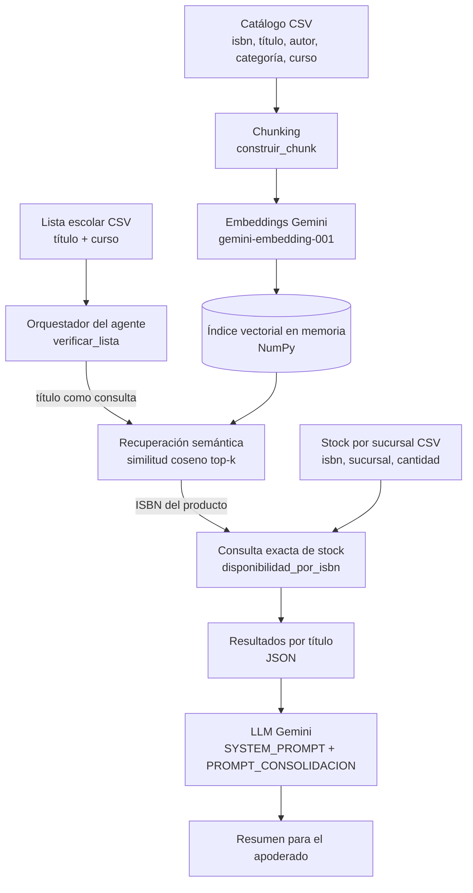
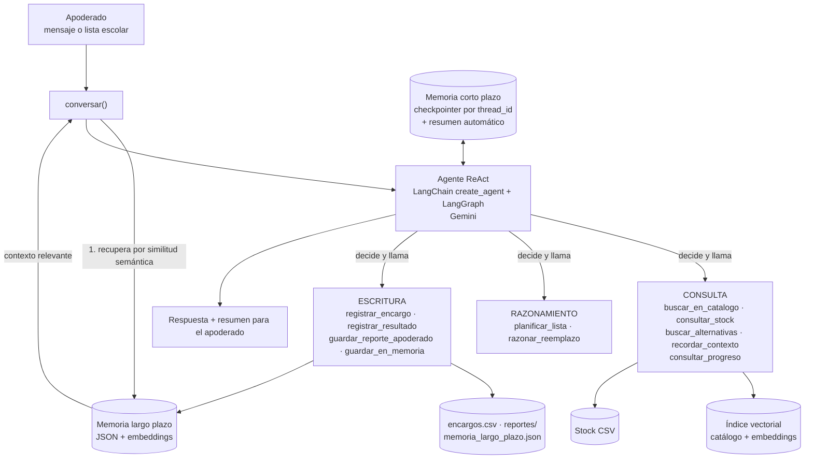
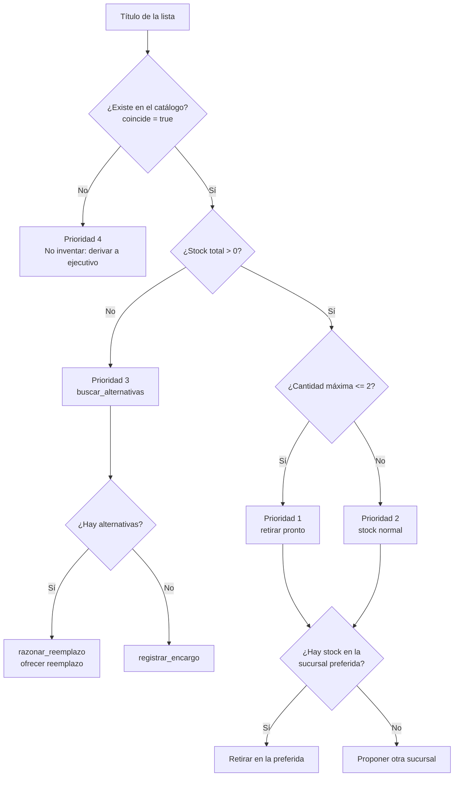

# 📚 Agente de Verificación de Listas Escolares (RAG) — Librería Antártica

**Asignatura:** Ingeniería de Soluciones con IA (ISY0101)
**Evaluación:** Evaluación Parcial N°1 — Diseño de Solución con LLM y RAG
**Integrantes:** [Isaac Marambio], [Matias Oliarte]
**Docente:** [Cristian Andres Carcamo Mansilla] 

[](https://colab.research.google.com/github/TATI3567/ev1-Libreria-antartica/blob/main/proyecto.ipynb)


---

## 📌 Descripción del proyecto

Prototipo de agente basado en **LLM + RAG (Retrieval-Augmented Generation)** para el caso de **Librería Antártica**. El agente recibe la lista de útiles/libros escolares de un estudiante y, para cada título, verifica si existe en el catálogo, en qué sucursal hay stock y qué hacer si no está disponible. Al final redacta un resumen breve para el apoderado.

**Evaluación Parcial N°2:** se agrega un **agente funcional** (LangChain + LangGraph) con herramientas de consulta, escritura y razonamiento, memoria de corto y largo plazo, y planificación con decisiones adaptativas (ver [Parte 2](#-parte-2--agente-funcional-evaluación-parcial-n2)).

**Problema que aborda:** la verificación manual de listas escolares (título por título, sucursal por sucursal) es lenta, propensa a errores y se concentra en temporadas de alta demanda.

**Objetivos de la solución**

1. Identificar automáticamente cada título de una lista escolar dentro del catálogo, aunque la escritura no sea exacta (búsqueda semántica).
2. Consultar el stock exacto por ISBN y sucursal, sin que el LLM invente disponibilidad.
3. Entregar un resumen claro al apoderado: qué está disponible, dónde retirarlo y qué requiere reemplazo o encargo.

---

## 🏗️ Arquitectura de la solución



> Si necesitas el diagrama como imagen (para el informe o la presentación), expórtalo y guárdalo en `docs/arquitectura.png`.

### Componentes

| Componente | Función | Implementación |
|---|---|---|
| Fuentes de datos | Catálogo, stock por sucursal y lista escolar | Archivos CSV en `data/` (datos de muestra) |
| Chunking | Une los campos de cada producto en un texto único | `construir_chunk()` |
| Embeddings | Convierte chunks y consultas en vectores | Gemini `models/gemini-embedding-001` (`google-generativeai`) |
| Índice vectorial | Almacena los vectores del catálogo | Arreglo NumPy en memoria (`construir_indice()`) |
| Recuperación | Top-k por similitud coseno | `buscar()` |
| Consulta exacta | Stock > 0 por ISBN y sucursal | `cargar_stock()`, `disponibilidad_por_isbn()` |
| Orquestación | Flujo multi-paso por cada título de la lista | `verificar_lista()` |
| Generación | Resumen final para el apoderado | `consolidar_resumen_llm()` con Gemini |
| Control de contexto | Reglas de comportamiento del agente | `SYSTEM_PROMPT` (responder solo con el contexto entregado) |

### Flujo de información

1. Se cargan el catálogo, el stock y la lista escolar desde `data/`.
2. Cada producto del catálogo se convierte en un chunk de texto y luego en un embedding.
3. Por cada título de la lista, el agente recupera el producto más similar (top-1) del índice.
4. Con el ISBN recuperado, consulta el stock exacto y elige la sucursal con mayor cantidad.
5. Si no hay stock, marca el título como no disponible y sugiere consultar encargo.
6. Los resultados se consolidan en JSON y el LLM redacta el resumen para el apoderado.

---

## 🤖 Parte 2 — Agente funcional (Evaluación Parcial N°2)

La Parte 2 transforma el pipeline RAG de la Evaluación 1 (un flujo fijo) en un **agente** que decide qué herramienta usar en cada paso. Se implementa en las secciones 2.1 a 2.7 del mismo `proyecto.ipynb`; **todo el código de la Evaluación 1 se mantiene**.

### Diagrama de orquestación de componentes



### Herramientas del agente (IE1)

| Tipo | Herramienta | Qué hace |
|---|---|---|
| Consulta | `buscar_en_catalogo` | Búsqueda semántica (RAG) con puntajes y bandera `coincide` (evita aceptar títulos inexistentes) |
| Consulta | `consultar_stock` | Stock exacto por ISBN + decisión (`retirar`, `retirar_pronto`, `retirar_en_otra_sucursal`, `sin_stock`) |
| Consulta | `buscar_alternativas` | Hasta 3 reemplazos con stock (misma categoría o nivel) |
| Consulta | `recordar_contexto` / `consultar_progreso` | Lectura de memoria de largo y corto plazo |
| Razonamiento | `planificar_lista` | Evalúa la lista y devuelve el plan ordenado por prioridad |
| Razonamiento | `razonar_reemplazo` | El LLM elige el mejor reemplazo solo entre las alternativas entregadas |
| Escritura | `registrar_encargo` | Escribe `data/encargos.csv` (idempotente) |
| Escritura | `registrar_resultado` | Escribe el resultado por título en la memoria de sesión |
| Escritura | `guardar_reporte_apoderado` | Escribe `reportes/reporte_<apoderado>_<fecha>.md` |
| Escritura | `guardar_en_memoria` | Escribe un recuerdo (con embedding) en la memoria de largo plazo |

### Memoria (IE3 e IE4)

| Memoria | Mecanismo | Para qué sirve |
|---|---|---|
| **Corto plazo** | `InMemorySaver` de LangGraph por `thread_id` + `SummarizationMiddleware` (resume el historial al pasar de 40 mensajes) | Coherencia dentro de una conversación larga |
| **Corto plazo (estado)** | `EstadoSesion`: plan y resultado por título | Retomar listas largas sin repetir consultas (`consultar_progreso`) |
| **Largo plazo** | `MemoriaLargoPlazo`: JSON en `data/` con embeddings Gemini | Recordar preferencias entre sesiones (sucursal preferida, hijos, encargos) |
| **Recuperación semántica** | Similitud coseno sobre el catálogo (`buscar_con_score`) y sobre los recuerdos (`recuperar`) | Encontrar contexto por significado, no por palabras exactas |

### Planificación y toma de decisiones (IE5)

El agente planifica con `planificar_tareas()` y decide por título según el stock y las preferencias:



Las condiciones pueden cambiar a mitad de la conversación (por ejemplo, el apoderado cambia de sucursal preferida o agrega un título): el agente **replanifica** solo lo afectado y usa `consultar_progreso` para no repetir trabajo. La demostración está en el escenario 3 del notebook.

### Justificación de los componentes (IE9)

| Componente | Por qué se eligió |
|---|---|
| **LangChain `create_agent` + LangGraph** | Provee el bucle ReAct, *tool-calling*, estado por hilo y persistencia sin reinventarlos; escala a más herramientas o multi-agente y se integra con Gemini mediante `langchain-google-genai` |
| **Gemini (LLM y embeddings)** | Una sola API key para generar y recuperar; embeddings multilingües adecuados para español |
| **Stock como herramienta determinista** | La disponibilidad es un dato transaccional y no debe ser inventada por el LLM |
| **Planificador determinista** | Es predecible y auditable: atiende primero lo que se puede agotar y deja al final lo que requiere más pasos |
| **Memoria de largo plazo en JSON + embeddings** | Simple, auditable y sin servidor; en producción se reemplazaría por una base vectorial |
| **Escritura en CSV/Markdown** | Simula la integración con sistemas internos de encargos y reportes |

### Escenarios de demostración (IE7)

El notebook ejecuta cinco escenarios y guarda la traza de herramientas en `evidencias/escenarios_agente.md`:

1. **Lista completa:** planifica, verifica cada título, ofrece reemplazo para Sub Terra, registra encargo para *El Diario de Ana Frank* y guarda el reporte.
2. **Seguimiento (memoria de corto plazo):** responde sin repetir consultas.
3. **Cambio de condiciones:** el apoderado cambia de sucursal preferida y el agente vuelve a evaluar el stock.
4. **Nueva sesión (memoria de largo plazo):** recuerda sucursal preferida y encargos de la sesión anterior.
5. **Título inexistente:** informa que no está en el catálogo y ofrece derivar a un ejecutivo, sin inventar datos.

---

## 🧠 Prompts del agente

Definidos en el notebook, en la sección de plantillas de prompt:

| Prompt | Propósito | ¿Usado en el flujo actual? |
|---|---|---|
| `SYSTEM_PROMPT` | Rol del asistente, restricción a responder solo con el contexto, prohibición de inventar datos, cita de sucursal/fuente | Sí |
| `PROMPT_CONSOLIDACION` | Resumen para el apoderado (máx. 8 líneas) a partir de los resultados JSON | Sí |
| `PROMPT_DISPONIBILIDAD` | Consulta libre del cliente con contexto RAG y hasta 2 alternativas | Definido (no conectado al flujo) |
| `PROMPT_VERIFICACION_TITULO` | Salida estructurada en JSON por título | Definido (no conectado al flujo) |

---

## ✅ Requisitos previos

- Python 3.10 o superior (o una cuenta de Google para usar Google Colab).
- Una API Key de **Groq** (https://console.groq.com/keys, gratis), **Mistral** o **Google AI Studio** (Gemini).
- Acceso a internet.

## ⚙️ Instalación

```bash
git clone https://github.com/TU_USUARIO/NOMBRE_DEL_REPO.git
cd NOMBRE_DEL_REPO

python -m venv venv
source venv/bin/activate        # En Windows: venv\Scripts\activate

pip install -r requirements.txt
```

## 🔐 Configuración de variables de entorno

1. Copia el archivo de ejemplo:
   ```bash
   cp .env.example .env           # En Windows: copy .env.example .env
   ```
2. Abre `.env` y completa tus claves:
   ```
   GOOGLE_API_KEY=tu_api_key_de_google_ai_studio
   LLM_API_KEY=tu_api_key
   ```

   **Proveedor de IA (Groq, Mistral o Gemini):** se elige con `PROVEEDOR` en el `.env`.
   - `PROVEEDOR=groq` + `GROQ_API_KEY=...` (https://console.groq.com/keys): gratis y sin tarjeta. Groq solo ofrece LLM, así que los embeddings se calculan localmente con `fastembed` (modelo multilingüe; se descarga la primera vez). Si `fastembed` no se puede instalar, el notebook usa un respaldo por n-gramas de caracteres.
   - `PROVEEDOR=mistral` + `MISTRAL_API_KEY=...`: `mistral-embed` + `mistral-small-latest`.
   - `PROVEEDOR=gemini` + `GOOGLE_API_KEY=...`: Gemini.
   Si no defines `PROVEEDOR`, se elige según la clave que exista.
   Opcional: `GROQ_MODEL`, `MISTRAL_MODEL`, `GEMINI_MODEL`. para forzar el modelo de Gemini (si no se define, el notebook prueba una lista de modelos vigentes).

**Nunca subas el archivo `.env` al repositorio.** Ya está incluido en `.gitignore`. En el repositorio solo debe existir `.env.example`, con los valores vacíos.

> **En Google Colab:** no necesitas el archivo `.env`. Agrega tu clave en el panel de *Secrets* (ícono de llave) o define la variable `GOOGLE_API_KEY` en una celda antes de ejecutar el resto.

## ▶️ Ejecución

1. Abre `proyecto.ipynb` en Jupyter / VS Code, o con el botón de Colab de arriba.
2. Ejecuta **todas las celdas en orden** (*Run All*):
   1. Instalación de librerías.
   2. Carga de variables de entorno.
   3. Generación de los CSV de muestra en `data/` (catálogo, stock y lista escolar).
   4. Definición de los prompts.
   5. Funciones de stock, embeddings y recuperación.
   6. Ejecución del agente (`verificar_lista()`), que imprime el JSON consolidado.
   7. Generación del resumen final con el LLM.
   8. **Parte 2:** configuración, memoria y herramientas del agente (secciones 2.1 a 2.3).
   9. Creación del agente (sección 2.4): indexa el catálogo y prueba el modelo Gemini.
   10. Pruebas unitarias sin LLM (sección 2.5) → `evidencias/pruebas_unitarias.md`.
   11. Escenarios del agente (sección 2.6) → `evidencias/escenarios_agente.md`.

> Los archivos que escribe el agente quedan en `data/encargos.csv`, `data/memoria_largo_plazo.json` y `reportes/`.

---

## 📊 Ejemplo de uso

**Entrada** (`data/lista_escolar_ejemplo.csv`):

| titulo | curso |
|---|---|
| Papelucho | 3° Básico |
| El Principito | 5° Básico |
| Sub Terra | 1° Medio |

**Salida esperada** de `verificar_lista()` con los datos de muestra:

```json
[
  {
    "titulo": "Papelucho",
    "disponible": true,
    "sucursal": "Mall Costanera Center",
    "cantidad": 5,
    "alternativa_si_no_disponible": null
  },
  {
    "titulo": "El Principito",
    "disponible": true,
    "sucursal": "Mall Costanera Center",
    "cantidad": 2,
    "alternativa_si_no_disponible": null
  },
  {
    "titulo": "Sub Terra",
    "disponible": false,
    "sucursal": null,
    "cantidad": 0,
    "alternativa_si_no_disponible": "Consultar encargo"
  }
]
```

**Resumen para el apoderado:** [pega aquí el texto real que generó el LLM en tu ejecución].

> Reemplaza la salida esperada por la captura o el resultado real de tu ejecución, y guarda la evidencia en `evidencias/`.

---

## 🧪 Pruebas

| # | Caso de prueba | Resultado esperado |
|---|---|---|
| 1 | Título con stock en una sucursal (Papelucho) | `disponible: true`, Mall Costanera Center, cantidad 5 |
| 2 | Título con stock bajo (El Principito) | `disponible: true`, Mall Costanera Center, cantidad 2 |
| 3 | Título en catálogo sin stock (Sub Terra) | `disponible: false`, `alternativa_si_no_disponible: "Consultar encargo"` |
| 4 | Título escrito con error o variación (ej. "papelucho 3 basico") | Recupera el producto correcto por similitud semántica |
| 5 | Título que no existe en el catálogo | El agente no inventa datos; se registra como no disponible |
| 6 | Sin `GOOGLE_API_KEY` válida | El notebook muestra el aviso y el resumen informa el error controlado |

| 7 | Lista con prioridades mezcladas | El plan ordena: stock crítico → normal → sin stock → no encontrado |
| 8 | Sin stock en la sucursal preferida | Propone la sucursal que sí tiene stock |
| 9 | Título sin stock con alternativas (Sub Terra) | Ofrece un reemplazo de la misma categoría |
| 10 | Título sin stock ni alternativas (El Diario de Ana Frank) | Registra un encargo (una sola vez) |
| 11 | Pregunta de seguimiento en el mismo hilo | Responde con `consultar_progreso`, sin repetir consultas |
| 12 | Nueva sesión del mismo apoderado | Recupera su sucursal preferida desde la memoria de largo plazo |

Capturas y resultados de estas pruebas: carpeta [`evidencias/`](evidencias/).

---

## 📁 Estructura del repositorio

```
├── README.md              # Este documento
├── proyecto.ipynb         # Notebook con el agente y el pipeline RAG
├── requirements.txt       # Dependencias
├── .env.example           # Plantilla de variables de entorno (sin claves reales)
├── .gitignore             # Excluye .env, venv, caches
├── data/                  # CSV de muestra, encargos y memoria de largo plazo (los genera el notebook)
├── reportes/              # Reportes para el apoderado escritos por el agente
├── docs/
│   ├── arquitectura.png   # Diagrama de arquitectura
│   └── bocetos/           # Bocetos de diseño
└── evidencias/            # Capturas de pruebas y ejecuciones
```

---

## ⚠️ Alcance y limitaciones actuales

- Los datos de catálogo, stock y lista escolar son **simulados** (muestra de 10 títulos; los 3 originales no cambiaron).
- El índice vectorial se reconstruye en memoria en cada ejecución; no hay base vectorial persistente.
- Las fuentes de datos son internas (CSV). [Completar aquí si agregan una fuente externa, por ejemplo una API o sitio web.]
- Los prompts `PROMPT_DISPONIBILIDAD` y `PROMPT_VERIFICACION_TITULO` están definidos pero no forman parte del flujo ejecutado.
- Parte 2: los umbrales `UMBRAL_COSENO` y `UMBRAL_LEXICO` deben calibrarse con el catálogo real; el checkpointer `InMemorySaver` se pierde al reiniciar el kernel (la memoria de largo plazo sí persiste).
- Parte 2: la memoria de largo plazo es un JSON local; en producción debería ser una base vectorial.
- Los modelos de Gemini cambian con el tiempo: si `consolidar_resumen_llm()` devuelve un error de modelo no encontrado, actualiza el nombre del modelo por uno vigente en Google AI Studio.

---

## 🤖 Uso de Inteligencia Artificial

Según la pauta, todo uso de IA debe declararse y citarse (https://bibliotecas.duoc.cl/ia). Completar:

| Herramienta | Para qué se usó |
|---|---|
| [Claude] | [En la elaboración de este documento se utilizó Claude (Anthropic) como apoyo para: estructurar el informe, redactar el borrador de las secciones de análisis del caso, formulación de prompts, diseño del pipeline RAG y arquitectura de la solución, y generar el diagrama de arquitectura. El equipo revisó, validó y ajustó todo el contenido generado para asegurar su coherencia con el caso organizacional y los requerimientos técnicos del proyecto. Las conclusiones y reflexiones individuales fueron redactadas exclusivamente por los integrantes del equipo, sin apoyo de IA.] |

> Completar con las herramientas de IA usadas en la Evaluación 2 y cómo se aplicaron (la pauta prohíbe usar IA para las conclusiones y reflexiones individuales).

---

## 📖 Referencias

Anthropic. (2026). *Claude* [Modelo de lenguaje]. https://www.anthropic.com

Google. (s. f.). *Gemini API documentation*. https://ai.google.dev/gemini-api/docs

Harris, C. R., Millman, K. J., van der Walt, S. J., Gommers, R., Virtanen, P., Cournapeau, D., Wieser, E., Taylor, J., Berg, S., Smith, N. J., Kern, R., Picus, M., Hoyer, S., van Kerkwijk, M. H., Brett, M., Haldane, A., del Río, J. F., Wiebe, M., Peterson, P., … Oliphant, T. E. (2020). Array programming with NumPy. *Nature, 585*(7825), 357–362. https://doi.org/10.1038/s41586-020-2649-2

LangChain. (s. f.). *LangChain and LangGraph documentation*. https://docs.langchain.com

Lewis, P., Perez, E., Piktus, A., Petroni, F., Karpukhin, V., Goyal, N., Küttler, H., Lewis, M., Yih, W., Rocktäschel, T., Riedel, S., & Kiela, D. (2020). Retrieval-augmented generation for knowledge-intensive NLP tasks. *Advances in Neural Information Processing Systems, 33*, 9459–9474.

Park, J. S., O'Brien, J. C., Cai, C. J., Morris, M. R., Liang, P., & Bernstein, M. S. (2023). Generative agents: Interactive simulacra of human behavior. En *Proceedings of the 36th Annual ACM Symposium on User Interface Software and Technology (UIST '23)*. https://doi.org/10.1145/3586183.3606763

Yao, S., Zhao, J., Yu, D., Du, N., Shafran, I., Narasimhan, K., & Cao, Y. (2023). ReAct: Synergizing reasoning and acting in language models. *International Conference on Learning Representations (ICLR 2023)*. https://arxiv.org/abs/2210.03629
